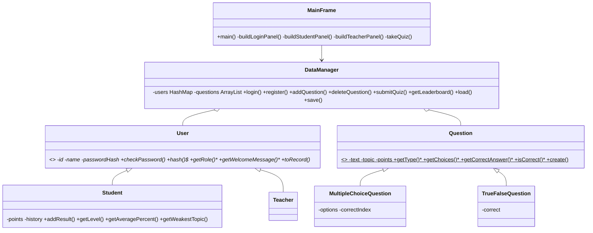

# LearnSmart – A Smart Learning Platform for SDG 4: Quality Education

**Course:** DIT1113 / BIT1123 / BISE2093 Object Oriented Programming – Final Project (Group, 40%)
**Group:** 40   **Class code:** ____   **Program:** ____
**Members:** (Full name – Student ID) × 4–5
**GitHub repository:** https://github.com/____/LearnSmart

---

## 1. Introduction & SDG Background
SDG 4 aims to "ensure inclusive and equitable quality education and promote lifelong learning opportunities for all". Many learners lack quick feedback and motivation, and teachers lack simple tools to see where students struggle. **LearnSmart** is a Java Swing application that simulates a small online learning platform where teachers create quiz questions and students learn through topic quizzes, XP points, levels, recommendations and a leaderboard.

## 2. Problem Statement
1. Learners do not receive immediate feedback on the topics they find difficult.
2. Learners lose motivation when progress is not visible.
3. Teachers cannot easily see each student's level and average score.
4. Small schools and study groups need a simple, free tool for quizzes.

## 3. System Objectives
- Provide Student and Teacher accounts (login and registration, hashed passwords).
- Let teachers add and delete multiple-choice and true/false questions grouped by topic.
- Grade quizzes automatically and show an answer-by-answer review.
- Motivate learners with XP, four levels and a leaderboard.
- Recommend the weakest topic to each student.
- Show teachers a table of student levels, XP, number of quizzes and averages.
- Keep all data in a file so nothing is lost.

**SDG 4 link:** Target 4.1 (effective learning outcomes – feedback and recommendations), Targets 4.3/4.5 (free, accessible learning tool), Target 4.4 (skills through practice).

## 4. OOP Design (UML Class Diagram)



**Packages:** `learnsmart.model` (6 classes), `learnsmart.data` (1 class), `learnsmart.ui` (1 class). **Total: 8 classes.**

## 5. Implementation Details

| OOP principle | Where it is applied |
|---|---|
| Classes & Objects | 8 classes: `User`, `Student`, `Teacher`, `Question`, `MultipleChoiceQuestion`, `TrueFalseQuestion`, `DataManager`, `MainFrame`. |
| Encapsulation | All fields are `private` with getters/setters. The password is stored only as a SHA-256 hash and checked by `checkPassword()`. |
| Inheritance | `User → Student, Teacher`; `Question → MultipleChoiceQuestion, TrueFalseQuestion`. |
| Polymorphism | Overriding `getRole()`, `getWelcomeMessage()`, `isCorrect()`, `getChoices()`, `getCorrectAnswer()`. Runtime polymorphism: `submitQuiz()` calls `q.isCorrect()` on `Question` references. |
| Abstraction | Abstract classes `User` and `Question`. |
| Collections | `HashMap` (users), `ArrayList` (questions, history), `TreeSet` (topics), streams. |
| File handling | `DataManager.load()` / `save()` write and read `data/learnsmart.txt`. |
| Decisions & loops | Level calculation, grading loop, input validation, weakest-topic search. |

**Main functions:** login/registration; teacher adds and deletes questions; student chooses a topic, takes a shuffled quiz and sees a review; XP = 10 per point + 50 bonus for a perfect score; levels Beginner (<100 XP), Learner (<300), Scholar (<600), Master; recommendation of the weakest topic; leaderboard; teacher's student table.

## 6. Testing & Sample Outputs

| # | Test | Input | Expected | Result |
|---|---|---|---|---|
| 1 | Wrong password | `student1 / bad` | "Wrong ID or password." | Pass |
| 2 | Duplicate ID | register `student1` | "This ID already exists." | Pass |
| 3 | Short password | `abc` | validation message | Pass |
| 4 | Quiz with one mistake | 3 of 4 correct (Java OOP) | 15/20, 150 XP, level Learner | Pass |
| 5 | Perfect quiz | all correct | 20/20, 250 XP (200 + 50 bonus) | Pass |
| 6 | Recommendation | after test 4 | "revise the topic Java OOP" | Pass |
| 7 | MCQ with 2 options | `1;2` | "Enter exactly 4 options…" | Pass |
| 8 | Persistence | close and reopen | users, questions and results still there | Pass |
| 9 | Password in file | open `data/learnsmart.txt` | only a hash, no plain password | Pass |
| 10 | Delete question | teacher deletes one | question count decreases | Pass |

**Sample output of the logic test:**
```
score=15/20 xp=150 level=Learner weakest=Java OOP
perfect=20/20 xp=250 total=400 avg=88%
reloaded: xp=400 history=2 questions=8
leaderboard=[Ali (student1), Sara (student2), Omar (newkid)]
```
*(Insert GUI screenshots here: Login, Take Quiz, Quiz review, My Progress, Leaderboard, Teacher – Add Question, Question Bank, Students.)*

## 7. Discussion & Limitations
**Discussion:** OOP keeps the design simple and extendable: a new question type (e.g. short answer) needs only a new subclass of `Question` and one line in `Question.create()`; the grading code does not change.
**Limitations:** file storage instead of a database; single computer; plain SHA-256 without salt (production systems use bcrypt); only two question types; no timer or lesson content.
**Future work:** short-answer questions, timed quizzes, charts, lesson materials, online server.

## 8. Conclusion
LearnSmart satisfies all mandatory requirements with 8 well-designed classes, encapsulation, inheritance, polymorphism, abstraction, collections, file persistence and a Swing GUI. It supports SDG 4 by giving learners instant feedback and motivation, and teachers a simple overview of their students.

---

## Student AI Declaration (AI Level 2 – Collaborative)
"I declare that I used **Claude (Anthropic)** in preparing this assessment for **generating a draft of the code and report and explaining concepts**. I have reviewed and critically evaluated the output, verified relevant information and modified the material as appropriate. I accept full responsibility for the accuracy, integrity and final content of my submission."

Signatures: ______________________ (each member)
